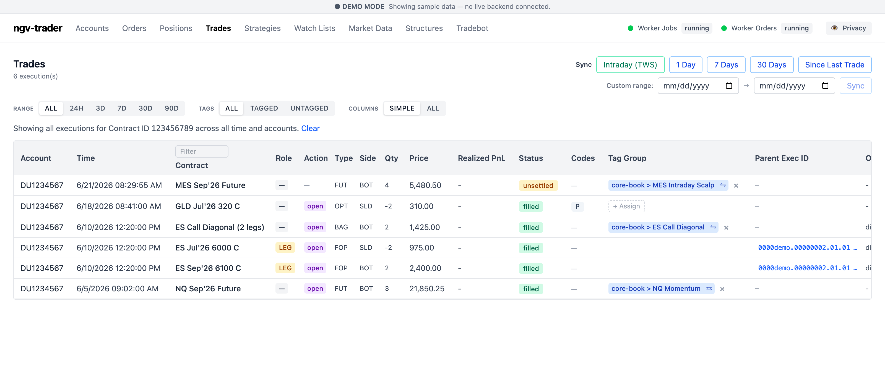

# Next Gen Vol (NGV) Trader

`ngv-trader` is a (Python backend + Typscript frontend) supporting traders/PMs managing strategies across multiple IBKR accounts.

## Features

- **Supported Instruments** — Equities, Equity Options, Futures, and Future Options.

- **Trades** — Pull down trade history from IBKR via either FlexQuery reports and live from the Trader Workstation.

- **Strategies** — Categorize trades and link to user defined 'Strategies' to track on-going realized/unrealized P&L for strategies run within your portfolio(s).

- **Positions & live P&L** — Track positions across accounts with unrealized P&L, plus a live intraday TWS overlay showing current marks.

## Getting Started

New to the project? Follow the [Getting Started guide](docs/getting-started.md) for a full walkthrough covering prerequisites, database setup, IBKR configuration, and running the app.

## License

This project offers two license options:

- **Personal Use (free):** for an individual managing less than $1 million USD in AUM.
- **Commercial (super reasonable):** for everything else — reach out to sales@nextgenvol.com.

See [LICENSE](./LICENSE) for full terms.
