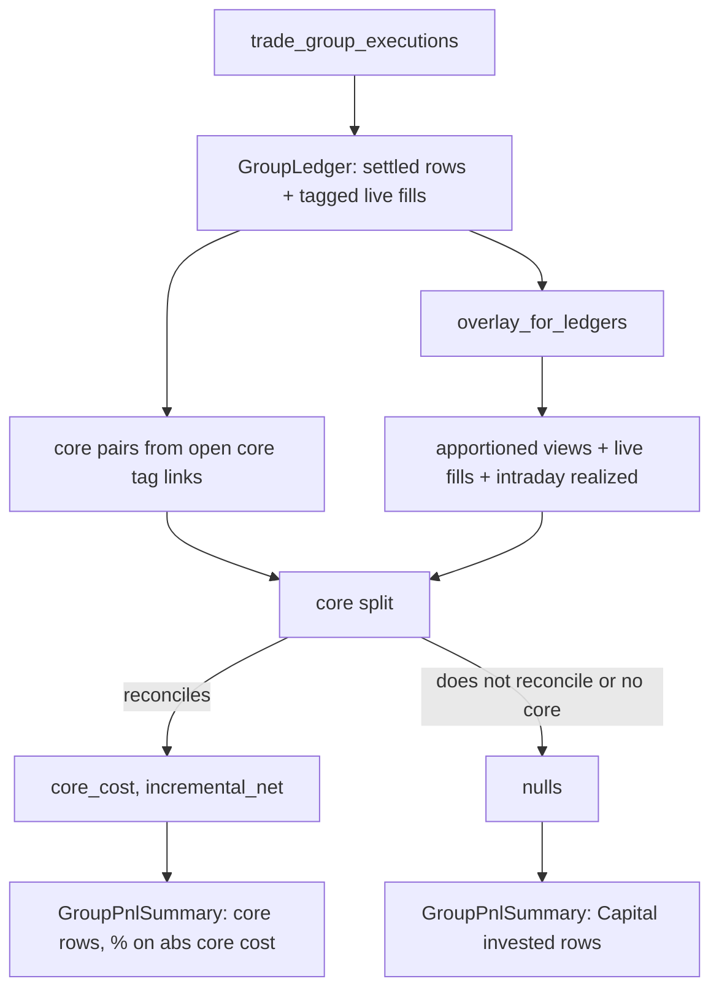

# Core vs Incremental P&L - Plan

## Goal Capsule

- **Objective:** On a trade group's detail card, the operator sees what the core position cost over its life, how much the other trades have paid back, and P&L as a percent of that core cost. This holds across rolls of the core or of the financing trades.
- **Means:** a reserved `core` tag on orders decides each contract's role. The backend splits the group's existing cost basis and realized P&L by role (KTD1, KTD2).
- **Authority:** the "Group P&L card: core vs incremental" section of `docs/design/strategies-and-trade-groups.md` (the origin spec, folded in at ship) owns product behavior. This plan owns the mechanism. If they conflict, the spec wins and the plan is updated.
- **Stop conditions:** stop and ask if the split cannot reconcile to the group's realized P&L on real FlexQuery data (KTD4), or if a `core` tag already exists in a shared database with links the operator did not make.
- **Execution profile:** backend first (U1–U3), then frontend (U4), then docs at ship (U5). Each unit lands as its own commit on a feature branch.
- **Finishes and ships:** the implementer opens a PR. The operator merges it.

---

## Product Contract

### Summary

Compute a core/incremental split of each trade group's cost and realized P&L on the backend and return it from the group detail endpoint. The detail card shows Core cost, Incremental net, % financed and Net cost in place of Capital invested, and takes its P&L percentages against |core cost|. The `core` tag name is protected. Only the detail card changes.

### Problem Frame

See origin: the former `spec-core-incremental-pnl.md` (Problem), now folded into `docs/design/strategies-and-trade-groups.md`. Today's "Capital invested" moves on every roll and can't say how much of a long-term outlay the financing trades have paid back.

### Requirements

**Role**

- R1. A contract (`account_id`, `con_id`) is core within a group when any of the group's orders on it carries an open `core` tag. That covers settled trades and unsettled live fills. Every fill on a core contract counts as core (spec rules 1, 2, 5).
- R2. A `core` tag on a combo order makes every leg core (spec rule 4).
- R3. Tags on positions and on trade groups never assign a role (spec rule 5).

**Figures**

- R4. Core cost = Σ open cost basis of core contracts − Σ realized P&L of core fills (spec Figures).
- R5. Incremental net = Σ realized P&L of incremental fills − Σ open cost basis of incremental contracts other than futures. An open incremental future adds 0 (spec rule 7).
- R6. Both figures include today's unsettled fills, so a roll that has not settled yet does not shift core cost (spec Figures).
- R7. Total PnL is unchanged. Total, Unrealized and Realized % are taken against |core cost| in the settled and intraday blocks.

**Display**

- R8. No core contract, or core cost = 0: the card renders exactly as today.
- R9. Core cost > 0: the card shows Core cost, Incremental net with % financed, and Net cost in place of the Capital invested rows.
- R10. Core cost < 0: the card shows Core cost and Incremental net, with no % financed and no Net cost.
- R11. Only the group detail card changes. The Strategy P&L list, the `trade_group_pnl` tool and the By-account panel are unchanged.

**Tag protection**

- R12. The `core` tag cannot be renamed, archived or merged. No other tag can be renamed or merged into `core`. Changing its color is allowed.

### Key Decisions

- **Combo tags cover every leg.** (session-settled: user-directed — chosen over also allowing `core` on positions: accepted that a calendar opened as one order counts its short leg as core; finer handling can come later.) Governs R2, R3.
- **Short cores show the split on |core cost|.** (session-settled: user-directed — chosen over long cores only, and over magnitude everywhere: keeps P&L % honest for short futures while dropping rows that assume an outlay.) Governs R7, R10.
- **Open incremental futures add 0 to incremental net.** (session-settled: user-approved — chosen over counting notional: a future costs no cash to open.) Governs R5.
- **Card only.** (session-settled: user-directed — chosen over also adding the figures to the `trade_group_pnl` tool and the Strategy P&L list.) Governs R11.
- **By-account panel unchanged.** (session-settled: user-approved — chosen over a per-account Core cost column.) Governs R11.

### Acceptance Examples

- AE1. **Covers R4, R5, R9.** Given a group with a `core` long 550C at avg cost 12,190.78, closed short calls realized 327.15, and one short call open at −79.95: core cost 12,190.78, incremental net 407.10, 3.34% financed, net cost 11,783.68.
- AE2. **Covers R1, R4.** Given a `core` Mar put bought for 3,000 and sold for 500 by an untagged order, then a `core` Jun put bought for 3,200: core cost 5,700.
- AE3. **Covers R2, R4, R5.** Given a calendar combo tagged `core` (buy Dec'28 550C 12,190.78, sell Dec'26 550C 800), then an untagged roll (buy back Dec'26 300, sell Jan'27 900): core cost 11,690.78, incremental net 900.
- AE4. **Covers R7, R10.** Given a `core` short 1× /ES at 6,000 and short puts open for a 3,000 credit: core cost −300,000, incremental net 3,000, % taken against 300,000, no % financed or Net cost.
- AE5. **Covers R5.** Given a `core` long put and an open incremental long future with cost basis 300,000 and 1,500 of closed futures realized: incremental net 1,500.
- AE6. **Covers R8.** Given a group with no `core` tag: response `core_cost` and `incremental_net` are null and the card is unchanged.

### Scope Boundaries

- Risk reversals and other cores that cost about zero; their % base is unsolved.
- Per-leg roles inside one combo order.
- Lot splitting of one contract between roles.
- Margin or allocated-capital bases.
- The Strategy P&L list, the `trade_group_pnl` tool, and the By-account Capital column.
- Considered and not built: a database migration to seed `core`. The tag is created on first use like any other, and protection keys on the normalized name. Revisit if the operator wants `core` to show up in the tag picker before first use.

---

## Planning Contract

### Key Technical Decisions

- KTD1. **Role resolution reads tag links, scoped to the group's own fills.** Core pairs are the `(account_id, con_id)` of the group's settled executions whose `trade_id` has an open `core` trade link, plus the group's unsettled live fills whose `ib_exec_id` has an open `core` live-execution link. Combo summaries are skipped because they carry no leg `con_id`. The result is intersected with `GroupLedger.pairs`. Live-fill tags already fan out to every fill of the order (`POST /tag-links`), so a tagged live combo marks all its legs. Implements R1–R3.
- KTD2. **One pure function computes the split from the overlay the endpoint already builds.** `trade_group_executions` already runs `overlay_for_ledgers`. The new function takes the `GroupOverlay`, the ledger, the live fills the overlay used, and the core pairs, and returns core cost and incremental net, or nothing. Open cost basis is `avg_cost × position` over the overlay's apportioned views, so a contract shared with another group counts only this group's share. Futures are identified by `sec_type` in the same delta-one set the frontend uses (`FUT`, `CONTFUT`, `FUTURE`), excluding `STK`. Implements R4, R5.
- KTD3. **Realized P&L splits per contract from leg-level fills, with the same partition as the intraday totals.** Settled: sum `execution_realized_pnl` per pair over the ledger's non-combo-summary rows. Live: the overlay's live fills for the group's pairs, deduped against settled exec ids with `dedupe_live_realized`, summed per pair. Core realized plus incremental realized then equals `overlay.totals.intraday_realized`. FlexQuery's synthesized combo summaries carry no realized P&L (`fill_ingest._synthesize_combo_summary`), so leg sums are complete for settled data. Implements R6.
- KTD4. **No split when it does not reconcile.** If core realized plus incremental realized differs from the overlay's intraday realized by more than one cent, return no split. That would happen with a TWS-native combo summary carrying realized P&L its legs do not. The card then falls back to Capital invested. Wrong figures would mislead; a missing split is visible. Implements R8.
- KTD5. **Response shape: two nullable fields.** `core_cost` and `incremental_net` on `TradeGroupExecutionsResponse`, both null when there is no split, both set when there is. A separate `has_core` flag would be redundant. Fields are additive, so existing consumers are unaffected. Implements R8, R11.
- KTD6. **Display rules live in one pure frontend function.** A function in `groupPositions.ts` takes the response and returns the rows to render and the % base: core split when `core_cost` is non-null and non-zero, else today's `groupCapital`. `GroupPnlSummary` renders from it. The existing `groupCapital` and `capitalForAccount` stay as they are; the By-account panel keeps using them. Implements R7–R10.
- KTD7. **Tag protection is a service-level guard on the normalized name.** `src/services/tags.py` gains the reserved-name constant and a guard that raises `TagError` (HTTP 400 through the existing error mapping). The `patch_tag` (value change only), `archive_tag` and `merge_tag` routes call it. Color patches pass. Implements R12.

### High-Level Technical Design

Data flow for the detail endpoint. Directional, not a specification.

### Assumptions

- `LiveExecution.realized_pnl` per leg is populated for TWS combo fills the same way it is for single fills. U1's reconciliation test with a live combo fixture confirms it.
- No existing `core` tag in production carries links the operator didn't make. The implementer checks with a read-only query before shipping (Goal Capsule stop condition).

---

## Implementation Units

### U1. Core split computation

- **Goal:** a pure function that turns a group's overlay, ledger, live fills and core pairs into core cost and incremental net, or nothing.
- **Requirements:** R4, R5, R6, R8; KTD2, KTD3, KTD4.
- **Dependencies:** none.
- **Files:**
  - `src/services/trade_group_pnl.py`
  - `tests/test_trade_group_core_split.py` (new)
- **Approach:**
  1. Expose the live fills the overlay used for the group's pairs on `GroupOverlay` (the `exec_slice` `_overlay_one` already builds), so the split and the intraday totals read one list.
  2. Add a frozen `CoreSplit` dataclass and the split function beside `GroupOverlay`.
  3. Open basis per apportioned view, role by pair, futures excluded on the incremental side only (KTD2).
  4. Realized per pair from settled leg rows plus deduped live fills (KTD3), then the reconciliation guard (KTD4).
  5. Return nothing when there are no core pairs or core cost is 0.
- **Patterns to follow:** `apportion_to_group` and `_account_breakdown` for per-pair partitioning; `tests/test_trade_group_position_split.py` and `tests/trade_group_factories.py` for fixtures.
- **Test scenarios:**
  - Covers AE1. LEAP core with closed and open short calls gives 12,190.78 and 407.10.
  - Covers AE2. Rolled put: the untagged sell of the core Mar put counts as core and core cost is 5,700.
  - Covers AE3. Calendar combo tagged core: both legs core, the roll's Jan'27 leg incremental, figures 11,690.78 and 900.
  - Covers AE4. Short future core returns a negative core cost of −300,000.
  - Covers AE5. Open incremental future adds 0; its closed realized 1,500 counts.
  - Covers AE6. No core pairs returns nothing.
  - Core pairs present but core cost exactly 0 returns nothing.
  - A core contract opened today (live fill only, no settled row) counts its live view's basis.
  - Roll day: a core contract closed by an unsettled live fill counts that fill's realized, so core cost matches the settled result for the same trades.
  - A live fill already settled under the same `ib_exec_id` is counted once.
  - A contract shared with another group uses only this group's apportioned position.
  - A combo summary row carrying realized P&L that its legs lack fails reconciliation and returns nothing.
  - Core plus incremental realized equals the overlay's intraday realized for a mixed group.
- **Verification:** all scenarios pass. Existing overlay and batch tests pass unchanged, which shows exposing the live fills changed no totals.

### U2. Core role resolution and endpoint fields

- **Goal:** the group detail endpoint resolves core pairs from tag links and returns `core_cost` and `incremental_net`.
- **Requirements:** R1, R2, R3, R11; KTD1, KTD5.
- **Dependencies:** U1, U3 (for the reserved-name constant).
- **Files:**
  - `src/services/trade_group_pnl.py`
  - `src/api/routers/trade_groups.py`
  - `tests/test_trade_groups_api.py`
- **Approach:**
  1. Add a loader that, given the ledger, returns core pairs with one tag-link query per entity type: trade links by the ledger's trade ids, live-execution links by the ledger's live `ib_exec_id`s. It filters on the `core` tag's normalized value and open links (KTD1).
  2. In `trade_group_executions`, call the loader and the U1 function after `overlay_for_ledgers`, and set the two new response fields.
  3. Leave `trade_group_batch_pnls`, `compute_trade_group_pnl` and the list endpoint untouched (R11).
- **Patterns to follow:** `_tagged_live_fills` for group-scoped queries; existing tag-link fixtures in `tests/test_tags_and_tasks.py`.
- **Test scenarios:**
  - A settled trade tagged `core` through `POST /tag-links` makes the response carry non-null figures.
  - A tagged live fill (unsettled) marks its contract core before settlement.
  - A `core` tag on the position of a group contract leaves the figures null (R3).
  - A `core` tag on the trade group itself leaves the figures null (R3).
  - A detached `core` tag (link removed) leaves the figures null.
  - A trade tagged `core` whose executions sit in a different group does not mark contracts in this group.
  - The list endpoint and `trade_group_pnl` output are unchanged for a group with a core tag.
- **Verification:** API tests pass. The response for a group without `core` is unchanged except for the two null fields.

### U3. Reserved `core` tag protection

- **Goal:** the `core` tag can't be renamed, archived or merged, and no tag can be renamed or merged into it.
- **Requirements:** R12; KTD7.
- **Dependencies:** none.
- **Files:**
  - `src/services/tags.py`
  - `src/api/routers/tags.py`
  - `tests/test_tags_and_tasks.py`
- **Approach:**
  1. Add the reserved normalized names and a guard to `tags.py`.
  2. Call it from `patch_tag` when `value` is present (checking both the current and the new normalized value), from `archive_tag`, and from `merge_tag` (checking source and target).
- **Patterns to follow:** existing `TagError` raises in `tags.py`; the duplicate-name check in `patch_tag`.
- **Test scenarios:**
  - Renaming `core` returns 400 and the name is unchanged.
  - Renaming another tag to `Core` or `core` (normalizes to `core`) returns 400.
  - Archiving `core` returns 400.
  - Merging `core` into another tag, or another tag into `core`, returns 400 and no links move.
  - Changing `core`'s color succeeds.
  - Creating and attaching `core` through `POST /tag-links` works like any tag.
- **Verification:** tag tests pass; other tag routes behave as before.

### U4. Card rendering

- **Goal:** the detail card shows the core split per R8–R10 and takes P&L % against |core cost|.
- **Requirements:** R7, R8, R9, R10; KTD6.
- **Dependencies:** U2.
- **Files:**
  - `frontend/src/types/tradeGroups.ts`
  - `frontend/src/lib/strategies/groupPositions.ts`
  - `frontend/src/lib/strategies/groupPositions.test.ts`
  - `frontend/src/components/strategies/GroupPnlSummary.tsx`
- **Approach:**
  1. Add the two nullable fields to `GroupExecutionsResponse`.
  2. Add the pure card-figures function (KTD6). It returns either the capital rows as today or the core rows, plus the % base.
  3. Render core rows in place of the Capital invested rows and their sub-rows. Keep the row layout, the formatters, privacy masking, and the intraday block structure. Both blocks use the same % base. The "3.34% financed" annotation goes in the third column. Widen the shared grid template (`7rem_6rem_5rem` today) for every row in both blocks so "Incremental net:" and the annotation fit without wrapping. Core cost and Net cost render neutral; Incremental net is colored like a P&L figure.
- **Patterns to follow:** `groupCapital` and its tests; the existing `row`/`subRow` helpers in `GroupPnlSummary`.
- **Test scenarios:**
  - Covers AE1. Debit core returns core cost, incremental net, 3.34% financed and net cost 11,783.68, with base 12,190.78.
  - Covers AE4. Negative core cost returns no % financed and no net cost, with base 300,000.
  - Covers AE6. Null fields return today's capital rows and base, matching `groupCapital`.
  - `core_cost` of 0 is treated like null.
- **Verification:** `bun run typecheck && bun run lint && bun test && bun run build` pass. In the running app, a group with a `core` trade shows the new rows and a group without one looks unchanged.

### U5. Docs at ship

- **Goal:** the design docs describe shipped behavior, and the spec is folded and deleted.
- **Requirements:** R12 (doc exception), spec "Doc changes at ship".
- **Dependencies:** U1–U4.
- **Files:**
  - `docs/design/tags-and-tasks.md`
  - `docs/design/strategies-and-trade-groups.md`
  - `docs/design/spec-core-incremental-pnl.md` (delete; folded into `docs/design/strategies-and-trade-groups.md`)
  - `docs/design/README.md` (regenerated)
- **Approach:**
  1. Add the rule 7 exception and the reserved-name note to `tags-and-tasks.md`.
  2. Fold the spec's rules, figures, examples and card into the P&L card section of `strategies-and-trade-groups.md`.
  3. Delete the spec and update links to it, including this plan's `origin`.
  4. Regenerate indexes and run the doc checks.
- **Test expectation:** none -- documentation only; `scripts/docs_check.py` is the gate.
- **Verification:** `docs_check.py` passes and no doc links to the deleted spec.

---

## Verification Contract

| Gate           | Command                                                                                             | Applies to          |
| -------------- | --------------------------------------------------------------------------------------------------- | ------------------- |
| Python tests   | `task test -- -k "core_split or trade_groups_api or tags_and_tasks or position_split or pnl_batch"` | U1, U2, U3          |
| Import check   | `uv run python scripts/check.py`                                                                    | U1–U3               |
| Lint and types | Ruff and Pyright per `docs/contributing/validation.md`                                              | U1–U3               |
| Frontend       | `bun run typecheck && bun run lint && bun test && bun run build` (in `frontend/`)                   | U4                  |
| Docs           | `uv run python scripts/docs_index.py` then `uv run python scripts/docs_check.py`                    | U5 and any doc edit |
| Brokerage data | `uv run python scripts/ibkr_sensitive_data_check.py` on staged files                                | every commit        |

Test fixtures use anonymized account and contract ids only.

---

## Definition of Done

- Every unit's verification holds and every gate above passes.
- AE1–AE6 each map to at least one passing test.
- A group with no `core` tag returns the same response as before plus two null fields, and its card is unchanged.
- No migration was added.
- The spec is folded into `strategies-and-trade-groups.md` and deleted.
- No abandoned-attempt code, debug output or unused helpers are left in the diff.
