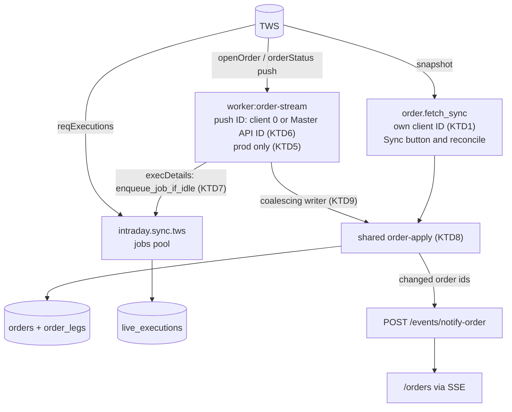
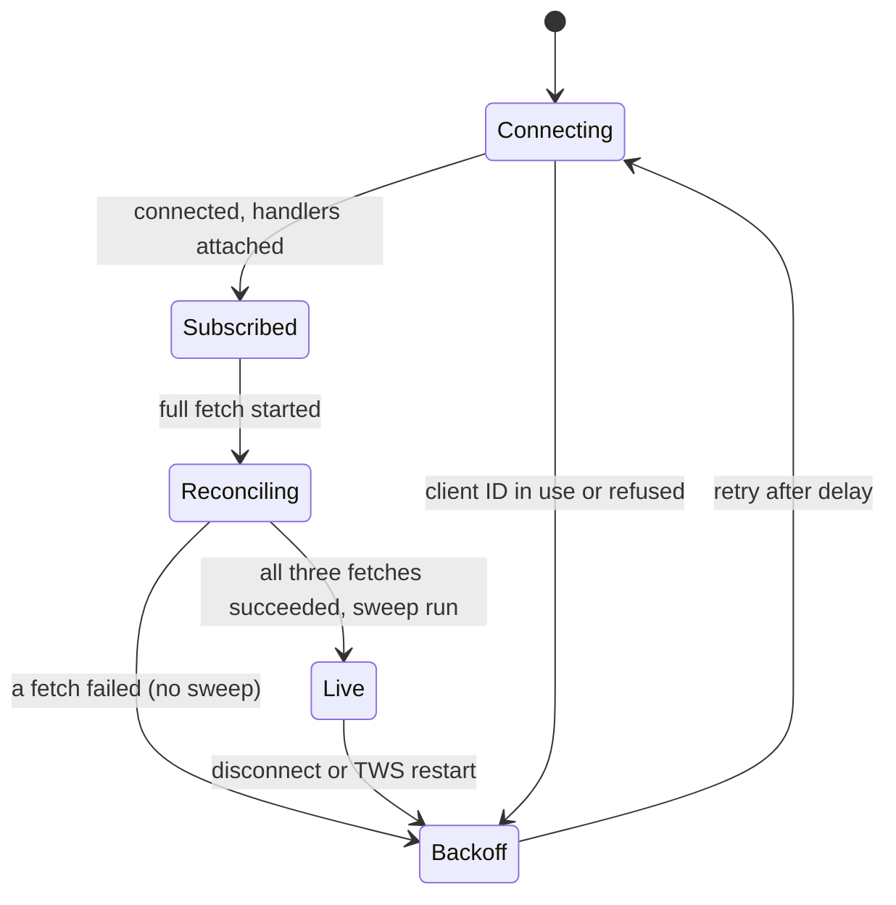
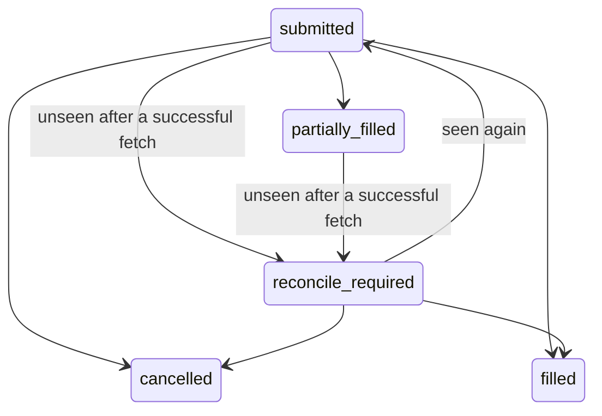
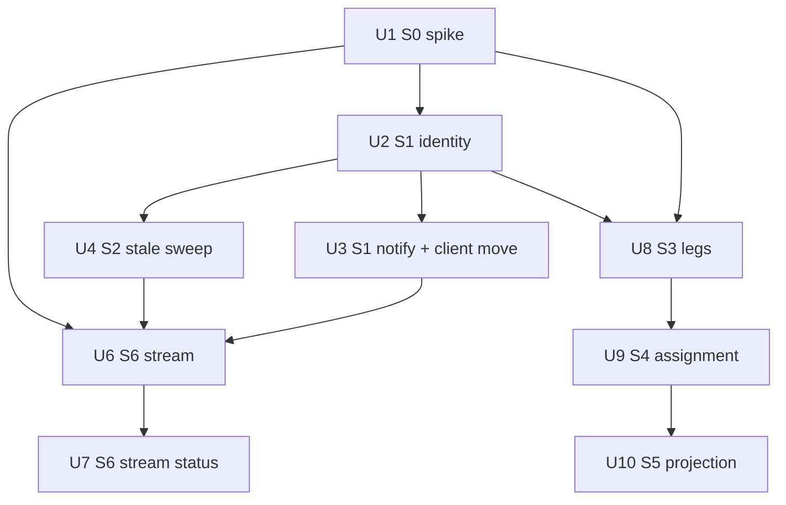

# Working Orders Live Sync and Strategy Overlay - Plan

## Goal Capsule

- **Objective:** The operator sees every working TWS order, including ones entered by hand, on `/orders` within seconds of placing it, without pressing Sync. Each order can be assigned to a strategy, and the strategy view reads current, working, and projected positioning.
- **Means:** Make the existing polled order sync correct, then add one long-lived streaming session that holds the TWS push client ID (KTD1, KTD5), then model combo legs, strategy assignment, and projection.
- **Authority hierarchy:** TWS is the only source of truth for order state. The app never places, modifies, or cancels a broker order. The submission guard in `src/services/order_worker.py` stays.
- **Execution profile:** Vertical slices. Each slice ends at something visible. S6 is U6 plus U7 in one PR; U2 and U6 are backend-only. Slice order: S0 spike, S1 identity and notify, S2 stale sweep, S6 stream, S3 legs, S4 assignment, S5 projection.
- **Stop conditions:**
  - Stop and ask if S0 shows that neither client 0 nor a Master API client ID receives push events for hand-entered orders. S6 then has no viable design.
  - Stop and ask if S0 shows a combo payload that the `order_legs` shape in U8 cannot hold.
  - Stop if any unit would write FlexQuery tables (`positions`, `trades`, `trade_executions`).
- **Tail ownership:** Standard repo flow: a branch and PR per slice, `task test`, and a demo-mode screenshot on the `media` branch for UI slices.

---

## Product Contract

Product Contract preservation: restructured from the superseded plan. R1–R9 keep their meaning. R10 now states the stream outcome. R11–R13 are new and come from keeping S6 in scope.

### Summary

The polled order sync exists but has identity bugs and its browser events are lost. This plan fixes it, then adds a persistent order stream so orders appear live. It then models combos as legs, lets an order be assigned to a strategy and carries that assignment onto its fills, and projects each strategy's position once its working orders fill.

### Problem Frame

The desk opens a strategy, decides an adjustment, and places resting orders well away from the touch. Those orders can rest for days. During that time the app shows only filled state, so the operator has to read TWS by hand to answer "have I already put in this adjustment?"

The code has moved since the August plan, and the gaps are now these:

- **Order identity is unsafe.** TWS reports permId 0 until it acknowledges an order. `_find_matching_order` in `src/services/order_sync_tws.py` matches any row whose `ib_perm_id` is 0, so unacknowledged orders merge. The orderRef path loads `ngtrader-order-<id>` with no check that the row belongs to that broker order. The `ib_order_id` fallback assumes orderId is unique, but it is unique only per client ID.
- **Browser events are lost.** `sync_orders_with_ib` publishes to the in-process broadcaster from the worker process, where no browser is subscribed (`docs/design/api-ux-sse.md` says the same).
- **Cancelled orders never resolve.** An order cancelled in TWS outside the completed-orders window stays `submitted`. `_collect_recent_trades` also swallows fetch errors, so a failed fetch looks the same as an empty book.
- **Client 0 is held for no benefit.** TWS pushes `openOrder` and `orderStatus` events for hand-entered orders only to client 0 or to the Master API client ID. `order.fetch_sync` connects as client 0 but only polls, and the session pool closes it after 300 s idle.
- **Combos flatten.** A `BAG` order becomes one `orders` row with an `Integer` quantity that `_safe_quantity` forces positive. `_derive_option_fields` in `src/api/schemas.py` mines a fake strike from the combo symbol.
- **Orders have no strategy.** Group membership is keyed by `ib_exec_id` everywhere (`trade_group_executions`, `trade_group_live_executions`, `src/services/group_link_carryover.py`). Nothing links an order to a trade group.

### Requirements

**Order fidelity**

- R1. Every working order visible in TWS, whether placed by the API or by hand and from any client, appears in `orders` after a sync.
- R2. A multi-leg order stores each leg with its own `con_id`, ratio, and action. The parent row identifies the combo, not a made-up single contract.
- R3. An order that no longer exists at the broker stops reading as working. Only a fetch that succeeded can mark a previously working order for reconciliation.
- R4. `ib_perm_id` is the unique broker identity of an order. An unacknowledged order (permId 0) never matches or merges with another order.

**Strategy overlay**

- R5. A working order can be assigned to a trade group, and its legs net against that group's positioning.
- R6. The trade group view reports current quantity, working quantity, and projected quantity per contract. This includes contracts the group holds none of yet.
- R7. When a working order fills, its group assignment carries onto every resulting fill with no manual step and no double count. This includes combos that fill in several partials.
- R8. Unassigned working orders are easy to find, so intent placed in TWS never escapes the strategy model unseen.

**Liveness**

- R9. Order state changes reach the browser without a manual refresh.
- R10. A new or changed TWS order reaches `/orders` within seconds without pressing Sync, through a persistent IBKR subscription.
- R11. Exactly one process holds the push client ID on a given TWS. Dev and prod never fight over it.
- R12. When the stream is down, `/orders` says so, and polling stays available as the fallback and the reconciliation path.
- R13. After any disconnect, the stream reconciles the full order book before it trusts events again. Events missed while disconnected never leave stale state.

### Key Decisions

- **Keep the persistent stream (S6) in this plan.** (session-settled: user-directed — chosen over deferring S6 to its own plan: the operator wants orders live, not only after a sync.) Governs R10, R11, R12, R13.
- **Land S6 right after S2, before legs, assignment, and projection.** (session-settled: user-approved — chosen over the August order that put S6 last: live orders are worth more sooner, and S6 depends only on S1 and S2.) Governs R10.

### Scope Boundaries

- Order submission, modification, and broker-side cancel from the app stay out of scope. `POST /orders/{id}/cancel` keeps its local-only behavior.
- Automatic strategy inference for orders is out of scope. Assignment is explicit.
- Tags and tasks on orders are out of scope. The `EntityType` and `ENTITY_SPECS` registry in `src/services/item_refs.py` would support an `order` type later, but nothing here needs it.
- The stream does not write fills (KTD7).
- Considered and not built: a separate coarse `notify-orders` endpoint. The per-order `POST /events/notify-order` already exists, and a sync changes few orders. Revisit if one sync changes hundreds of orders.

### Deferred to Follow-Up Work

- The ib_async v3 upgrade (`docs/plans/2026-11-19-001-chore-ib-async-v3-upgrade-plan.md`). This plan only keeps new code ready for it (KTD10).

---

## Planning Contract

### Key Technical Decisions

- KTD1. **The polled sync leaves client 0 in S1.** `order.fetch_sync` gets its own client ID from the jobs worker range. `reqAllOpenOrders` returns hand-entered orders on any client ID, so polling loses nothing, and client 0 is then free for the stream. The redundant `reqAutoOpenOrders` call in `_collect_recent_trades` goes with it.
- KTD2. **permId 0 is stored as NULL everywhere.** This applies to `_create_order_from_trade`, the match lookup, and `_live_execution_values` in `src/services/intraday_sync_tws.py`. A partial unique index on `orders.ib_perm_id WHERE ib_perm_id IS NOT NULL` enforces R4. `orders.ib_perm_id` and `live_executions.ib_perm_id` widen to `BigInteger` to match `trades` and `trade_executions`.
- KTD3. **Matching order: permId, then a guarded orderRef, then (client ID, orderId) only while permId is unknown.** An orderRef match must point at a row this app created (`source` set by the app) whose stored permId is NULL or equal. The orderId fallback also requires `ib_client_id` to match. It is skipped when orderId is 0 or the order was not placed by this app's client, because hand-entered orders can share orderId 0 while their permId is still 0.
- KTD4. **`_collect_recent_trades` reports whether each fetch succeeded.** The stale sweep (U4) and the stream's reconnect reconcile (U6) run only when all three fetches succeeded and returned without error.
- KTD5. **The stream is a new long-lived process, `worker:order-stream`, and is off unless enabled.** It does not live in the jobs session pool, which closes idle sessions, or in `worker:orders`, whose client 30 is reserved for future submission. An env setting enables it and is set only for prod. `.env.dev` and `.env.prod` point at the same TWS port, so a dev stream would contend for the push ID (R11).
- KTD6. **Push client ID: S0 chooses between client 0 and a dedicated ID set as TWS's Master API client ID.** The stream reads it from config. Either way, KTD5 guarantees one holder.
- KTD7. **The stream writes orders only. `execDetailsEvent` queues `intraday.sync.tws` through `enqueue_job_if_idle`.** If the job is already running when `execDetails` arrives, the stream schedules one follow-up run after it finishes, because the running job may have fetched before the new fill. That job stays the only writer of `live_executions`, which keeps commission handling in one place (see `docs/solutions/integration-issues/ib-async-req-executions-strips-commission-reports-2026-07-29.md`).
- KTD8. **One shared order-apply path.** The poll and the stream both call the same function that maps an ib_async `Trade` onto an `orders` row (and its legs, from U8). Upserts are keyed per KTD3. An insert runs in a savepoint; on a unique violation of the permId index, the function re-selects by permId and updates that row. Running the poll and the stream on the same order therefore converges.
- KTD9. **Stream events go into a queue drained by one writer that coalesces by order.** ib_async handlers run on the asyncio loop, and DB writes block. The writer collects events for about 250 ms, applies the latest state per order, commits, then POSTs `/events/notify-order` for each changed order.
- KTD10. **New quantity and price code converts ib_async values with `float()` on read.** ib_async v3 changes `totalQuantity`, `lmtPrice`, and `OrderStatus` fields to `Decimal | None`. Mixing `Decimal` and `float` raises `TypeError`.
- KTD11. **`trade_group_orders` is a new table keyed on `ib_perm_id`.** It is the first permId-keyed group link. The tag/task `EntityType` registry is a different system and is not reused for membership. Carryover joins `live_executions.ib_perm_id` and accepts many fills per permId, because a combo that fills in partials produces several summary rows with the same permId (CONCEPTS.md, Combo).
- KTD12. **The projection is computed from ledger pairs plus order pairs, outside `apportion_to_group`.** Apportionment drops contracts the group holds none of and scales by `held_fraction`. Projected quantity = the group's held quantity + unscaled working quantity.
- KTD13. **Data migrations use raw SQL, never live service code.** See `docs/solutions/logic-errors/data-migration-importing-live-code-breaks-fresh-db.md`. The permId dedup rule (keep the newest row by `updated_at`, set the rest to NULL) is stated in the migration docstring.

### High-Level Technical Design

Client ID ownership and data flow after S6:

Stream session lifecycle (R13):

Events that arrive while the session is `Reconciling` are queued and applied after the snapshot. The shared apply path converges either way (KTD8).

Order status as `/orders` buckets it after U4:

The transitions already exist in `ALLOWED_ORDER_STATUS_TRANSITIONS` (`src/services/order_queue.py`). U4 adds the trigger and moves `reconcile_required` out of the Working bucket.

### Sequencing

- Working orders appear live once S0, S1, S2, and S6 land (U1–U4, U6, U7).
- U8 needs only U1 and U2 (the shared apply function). It lands after S6 by slice order, so legs go into the shared apply path once, after both writers use it.
- U5 is not used. The August plan's notify unit is folded into U3.

### Assumptions

- The prod jobs worker and the stream run on the machine that hosts prod TWS, and dev runs only from the run seat (`docs/contributing/worktrees.md`).
- TWS restarts nightly and needs a weekly re-login. The stream treats both as an ordinary disconnect.

---

## Implementation Units

| U-ID | Title                                       | Key files                                                                                  | Depends on |
| ---- | ------------------------------------------- | ------------------------------------------------------------------------------------------ | ---------- |
| U1   | S0 payload and client-ID spike              | `scripts/dump_open_orders.py`, `tests/fixtures/tws_orders/`                                | —          |
| U2   | S1 order identity and safe matching         | `src/services/order_sync_tws.py`, `src/models.py`, `alembic/versions/`                     | U1         |
| U3   | S1 browser notify, client move, demo orders | `scripts/work_jobs.py`, `src/workers/jobs.py`, `frontend/src/lib/demoData.ts`              | U2         |
| U4   | S2 stale sweep and reconcile bucket         | `src/services/order_sync_tws.py`, `frontend/src/components/OrdersTable.tsx`                | U2         |
| U6   | S6 order stream worker                      | `src/services/order_stream_tws.py`, `scripts/work_order_stream.py`, `Taskfile.yaml`        | U1, U3, U4 |
| U7   | S6 stream status on /orders                 | `src/api/routers/orders.py`, `frontend/src/components/OrdersTable.tsx`                     | U6         |
| U8   | S3 combo legs                               | `src/models.py`, `src/services/order_sync_tws.py`, `src/api/schemas.py`                    | U1, U2     |
| U9   | S4 assign orders to strategies              | `src/models.py`, `src/services/group_link_carryover.py`, `src/api/routers/trade_groups.py` | U8         |
| U10  | S5 working and projected quantity           | `src/services/trade_group_pnl.py`, strategy view components                                | U9         |

### U1. S0 payload and client-ID spike

- **Goal:** Record the real TWS payloads and settle the questions that block S3 and S6.
- **Requirements:** R1, R2, R10, R11.
- **Dependencies:** None.
- **Files:**
  - `scripts/dump_open_orders.py` (create)
  - `tests/fixtures/tws_orders/` (create, anonymized)
- **Approach:**
  1. The script connects read-only and runs the three fetches `_collect_recent_trades` uses. It prints each `Trade`'s contract fields, `comboLegs`, `orderStatus`, `permId`, `orderId`, `clientId`, `parentId`, `ocaGroup`, and `orderRef`.
  2. A `--listen` mode attaches `openOrderEvent`, `orderStatusEvent`, and `execDetailsEvent` and logs a short event sequence.
  3. Run it by hand for a single-leg limit order and a multi-leg spread, both entered in TWS.
  4. Answer and record:
     - Does a session at client 0 receive push events for an order entered by hand after it connects? Does a session at the Master API client ID?
     - What `orderId` and `permId` does a hand-entered order carry before and after TWS acknowledges it?
     - Does binding at client 0 (`reqAutoOpenOrders(True)`) change how the order behaves in TWS? What `orderId` and `clientId` does a bound order report?
     - Does any observed permId exceed int32?
     - What leg ratio, action, and `totalQuantity` meaning does a spread report? Does a SELL BAG report inverted leg actions, or the same leg actions as BUY?
  5. Anonymize the payloads per `docs/ibkr-sample-data.md` and save them as fixtures for U2, U6, and U8.
- **Test expectation:** none -- a manual spike. Its output is the fixtures and the recorded answers.
- **Verification:** All five answers are written in the U1 PR description and the fixtures pass `scripts/ibkr_sensitive_data_check.py`.

### U2. S1 order identity and safe matching

- **Goal:** One row per broker order, with permId 0 never matching anything.
- **Requirements:** R1, R4.
- **Dependencies:** U1.
- **Files:**
  - `src/services/order_sync_tws.py` (modify)
  - `src/services/intraday_sync_tws.py` (modify `_live_execution_values`)
  - `src/models.py` (modify `Order`, `LiveExecution`)
  - `alembic/versions/<new>_order_perm_id_identity.py` (create)
  - `tests/test_order_sync_tws.py` (create)
- **Approach:**
  1. Normalize permId 0 to NULL at create, match, and update (KTD2).
  2. Add nullable `ib_client_id` to `orders` and populate it from `trade.order.clientId`.
  3. Rewrite `_find_matching_order` per KTD3.
  4. Migration: snapshot first per `docs/contributing/db-snapshots.md`. Set 0 to NULL, dedup per KTD13, widen both columns to `BigInteger`, and add the partial unique index.
  5. Pull the Trade-to-row mapping into one apply function that U6 will reuse (KTD8).
- **Execution note:** Start with characterization tests around `_sync_trade_onto_order` (some exist in `tests/test_complexity_refactor_characterization.py`) before changing matching.
- **Patterns to follow:** `parse_order_ref` and `_apply_trade_fields` in `src/services/order_sync_tws.py`. Partial unique indexes like `_active_unique` in `src/models.py`.
- **Test scenarios:**
  - A trade with permId 0 creates a row with NULL `ib_perm_id`. A second permId-0 trade creates a second row and does not merge.
  - A trade with permId 0 and then the same order with a real permId (same client ID and orderId) updates the first row.
  - A trade whose permId matches an existing row updates that row, even if its orderRef names a different row.
  - An orderRef `ngtrader-order-<id>` pointing at a row with a different non-NULL permId does not match.
  - An orderId match from a different client ID does not match.
  - Two hand-entered trades, both with permId 0 and orderId 0, create two rows and do not merge.
  - Syncing the same three-trade batch twice leaves three rows.
  - A live fill with permId 0 stores NULL `ib_perm_id`.
- **Verification:** The migration upgrades and downgrades on a fresh database and on a dev snapshot, and the new tests pass.

### U3. S1 browser notify, client move, and demo orders

- **Goal:** A hand-entered order appears on `/orders` after each poll without a refresh, and polling no longer holds client 0.
- **Requirements:** R9, R11.
- **Dependencies:** U2.
- **Files:**
  - `src/services/order_sync_tws.py` (modify: return created and updated ids, remove the in-process `broadcaster.publish`, remove `reqAutoOpenOrders`)
  - `src/workers/jobs.py` (modify: `handle_order_fetch_sync` client ID)
  - `scripts/work_jobs.py` (modify: notify each order id through `_notify_api`)
  - `frontend/src/lib/demoData.ts`, `frontend/src/lib/demoApi.ts` (modify: add `demoOrders` and the `/orders` route)
  - `frontend/src/components/OrdersTable.tsx` (modify: show when the last sync finished)
  - `tests/test_order_sync_tws.py`, `tests/test_work_jobs_notify.py` (create or extend)
- **Approach:**
  1. `sync_orders_with_ib` returns the counts plus `created_order_ids` and `updated_order_ids`.
  2. After the job commits, the worker POSTs `/events/notify-order` per id with `order.created` or `order.updated`.
  3. `order.fetch_sync` defaults to a free client ID in the jobs range (KTD1). Document the ID allocation in `docs/design/workers.md`.
  4. The table already updates from SSE and reloads through `useJobWatcher`. Only demo fixtures and the last-sync display are new.
- **Patterns to follow:** `_notify_coarse_for_job_type` and `_notify_api` in `scripts/work_jobs.py`. `NotifyOrderRequest` in `src/api/routers/events.py`.
- **Test scenarios:**
  - A sync that creates one order and updates one returns both ids in the right lists.
  - The worker posts one notify per changed id with the matching event name, and posts nothing when nothing changed.
  - A notify POST that fails or times out does not fail the job.
  - The handler connects with the configured client ID, not 0.
- **Verification:** In demo mode, `/orders` renders fixtures. Against TWS, a hand-entered order appears after Sync with no browser refresh.

### U4. S2 stale sweep and reconcile bucket

- **Goal:** An order cancelled in TWS leaves the Working count after the next successful sync.
- **Requirements:** R3.
- **Dependencies:** U2.
- **Files:**
  - `src/services/order_sync_tws.py` (modify: fetch-success flag, `last_seen_at`, sweep)
  - `src/models.py` and `alembic/versions/<new>_order_last_seen_at.py` (add nullable `last_seen_at`)
  - `frontend/src/components/OrdersTable.tsx` (modify: remove `reconcile_required` from `WORKING_STATUSES`, add a Needs-reconcile filter)
  - `tests/test_order_sync_tws.py` (extend)
- **Approach:**
  1. `_collect_recent_trades` returns trades plus a success flag (KTD4).
  2. Every observed order gets `last_seen_at` set.
  3. Record the fetch start time. Only on success, orders in `submitted` or `partially_filled` whose `last_seen_at` is older than the fetch start move to `reconcile_required` through `transition_order_status`. An order written by another path during the fetch is therefore not swept.
  4. A later sync that observes the order again moves it back by the normal status reconcile.
  5. `queued` orders are not swept. The state machine does not allow `queued` to go to `reconcile_required`, and queued orders have not reached the broker.
- **Patterns to follow:** `transition_order_status` and `ALLOWED_ORDER_STATUS_TRANSITIONS` in `src/services/order_queue.py`. The startup sweep in `reconcile_open_orders` (`src/services/order_worker.py`) stays as is.
- **Test scenarios:**
  - A successful fetch that omits a `submitted` order moves it to `reconcile_required` and records an order event.
  - A fetch where `reqAllOpenOrders` raises leaves every order unchanged.
  - A fetch that succeeds with zero trades sweeps all working orders. This is the real empty-book case.
  - A swept order seen again on the next sync returns to `submitted`.
  - A `queued` order is never swept.
  - An order created or updated after the fetch started, but missing from the fetch result, is not swept.
- **Verification:** On `/orders`, an order cancelled in TWS leaves the Working count after Sync and shows under Needs reconcile.

### U6. S6 order stream worker

- **Goal:** A TWS order change reaches `/orders` within seconds, with no Sync.
- **Requirements:** R10, R11, R13. Implements KTD5–KTD9.
- **Dependencies:** U1, U3, U4.
- **Files:**
  - `src/services/order_stream_tws.py` (create: session lifecycle, handlers, coalescing writer)
  - `scripts/work_order_stream.py` (create: process entry, heartbeat)
  - `Taskfile.yaml` (add `worker:order-stream`)
  - `src/utils/env_vars.py` (add the enable flag and push client ID)
  - `.env.example`, `.env.prod` (document the new settings, no secrets)
  - `tests/test_order_stream_tws.py` (create)
- **Approach:**
  1. On start, exit with a clear log line unless the enable flag is set.
  2. Connect at the push client ID (KTD6). If TWS refuses the ID because it is in use, back off and log. Never try another ID. When the push ID is 0, call `reqAutoOpenOrders(True)` after connecting so orders entered later in TWS are bound to this session.
  3. Attach handlers, then run the full fetch and sweep through the U2/U4 code (R13). Queue events that arrive during the fetch. Run the sweep before applying the queued events.
  4. Handlers push `(order identity, Trade)` onto a queue. One writer coalesces and calls the shared apply function (KTD8, KTD9), then notifies. Use the async fetch variants on the event loop.
  5. `execDetailsEvent` calls `enqueue_job_if_idle` for `intraday.sync.tws` (KTD7). If a run is already RUNNING, set a pending flag and enqueue one follow-up run when it finishes.
  6. Write a heartbeat row in `worker_heartbeats` with connection state and the time of the last event.
  7. On disconnect, back off and go back to step 2.
- **Execution note:** Test the handlers and writer with the U1 recorded event sequences before connecting to TWS.
- **Patterns to follow:** The long-lived loop and heartbeat in `scripts/work_order_queue.py`. `enqueue_job_if_idle` in `src/services/jobs.py`.
- **Test scenarios:**
  - The sequence new (permId 0) → acknowledged (real permId) → partial fill → cancelled ends as one row in `cancelled` with the right filled quantity.
  - Five status events for one order inside the coalescing window cause one write and one notify.
  - Events queued while reconciling are applied after the snapshot, and the final state matches the latest event.
  - A reconnect whose fetch fails does not sweep and does not enter Live.
  - `execDetailsEvent` enqueues `intraday.sync.tws` once while a run is already queued.
  - `execDetailsEvent` that arrives while a run is RUNNING causes exactly one follow-up run after it finishes.
  - The poll and the stream insert the same newly acknowledged order at the same time. One row results; the loser of the unique-index race re-selects by permId and updates.
  - An order event queued during reconcile is applied after the sweep, so the sweep does not move that order to `reconcile_required`.
  - With the enable flag unset, the process exits without connecting.
  - Read-only guard: no code path in the stream module calls `placeOrder`, `cancelOrder`, or `reqGlobalCancel`. Enforce this with a test that inspects the module.
- **Verification:** In prod with the flag set, a hand-entered order appears on `/orders` within a few seconds without Sync. Restarting TWS leaves the book correct after reconnect.

### U7. S6 stream status on /orders

- **Goal:** The operator can see whether orders are live or only polled.
- **Requirements:** R12.
- **Dependencies:** U6.
- **Files:**
  - `src/api/routers/orders.py` (modify: expose stream status from the heartbeat)
  - `src/api/schemas.py` (modify: status response)
  - `frontend/src/components/OrdersTable.tsx` (modify: status indicator beside Sync)
  - `frontend/src/lib/demoApi.ts` (modify: demo status)
  - `tests/test_orders_api.py` (extend or create)
- **Approach:** Report connected, disconnected, or disabled, plus the time since the last event. A heartbeat older than a threshold reads as disconnected. Sync stays as it is.
- **Patterns to follow:** Existing worker heartbeat reads, if any, in `src/api/routers/`. Otherwise read `WorkerHeartbeat` directly.
- **Test scenarios:**
  - A fresh heartbeat with a connected state returns connected and the last event time.
  - A heartbeat older than the threshold returns disconnected.
  - No heartbeat row returns disabled.
- **Verification:** The indicator changes when the stream process stops and starts.

### U8. S3 combo legs

- **Goal:** A spread entered in TWS shows as one parent row with correctly signed legs.
- **Requirements:** R2.
- **Dependencies:** U1, U2. Lands after S6 by slice order.
- **Files:**
  - `src/models.py` and `alembic/versions/<new>_order_legs.py` (create `order_legs`; change `orders.quantity` to `Float`; add `remaining_quantity`; add a combo role on `orders`)
  - `src/services/order_sync_tws.py` (modify the shared apply function: legs, unsigned raw quantity, remaining)
  - `src/api/schemas.py` (modify: remove `BAG` from `_derive_option_fields`; add legs and remaining to `OrderResponse`)
  - `frontend/src/components/OrdersTable.tsx`, `frontend/src/lib/demoData.ts` (modify: expandable legs, demo spread)
  - `tests/test_order_sync_tws.py`, `tests/test_order_schemas.py` (extend or create)
- **Approach:**
  1. `order_legs` stores `order_id`, `leg_index`, `con_id`, `ratio`, `action`, `exchange`, `open_close`, and display fields, unique on `(order_id, leg_index)`.
  2. The parent order's role reuses the `ExecRole` vocabulary (`combo_summary`, `standalone`).
  3. Per-leg signed quantity is `totalQuantity × ratio`, with its sign from the leg action alone, as U1 records for BUY and SELL BAGs. Convert with `float()` (KTD10).
  4. Remove `_safe_quantity`'s `abs()`, rounding, and minimum of 1.
  5. Unknown leg `con_id`s enqueue `contracts.qualify_and_snapshot` so names resolve through `ContractRef`.
- **Patterns to follow:** `_exec_roles_by_exec_id` in `src/services/intraday_sync_tws.py` for combo detection. `to_order_response` in `src/api/schemas.py`.
- **Test scenarios:**
  - A U1 spread fixture produces one parent and one leg per `comboLeg`, with signed quantities that match the ticket.
  - The U1 SELL spread fixture produces leg signs that match its ticket, using the leg actions as TWS reports them.
  - A 1×2 ratio spread of quantity 3 gives legs of 3 and 6.
  - A fractional `totalQuantity` is stored as given.
  - A BAG order response has no derived strike or right.
  - `remaining_quantity` equals quantity minus filled after a partial fill.
- **Verification:** A spread entered in TWS renders under one parent on `/orders` with named legs, in both the stream and poll paths.

### U9. S4 assign orders to strategies

- **Goal:** A working order can be assigned to a strategy, and the assignment follows its fills.
- **Requirements:** R5, R7, R8.
- **Dependencies:** U8.
- **Files:**
  - `src/models.py` and `alembic/versions/<new>_trade_group_orders.py` (create `trade_group_orders`)
  - `src/services/group_link_carryover.py` (modify: order to live-fill carryover)
  - `src/services/intraday_sync_tws.py` (modify: apply order links when writing fills)
  - `src/api/routers/trade_groups.py` (modify: order assign and unassign endpoints)
  - `frontend/src/components/OrdersTable.tsx` and the strategies view (modify: assign control with `TradeGroupSearchSelect`, an Unassigned filter, and a badge)
  - `tests/test_group_link_carryover.py` (create), `tests/test_trade_groups_api.py` (extend)
- **Approach:**
  1. `trade_group_orders` holds `trade_group_id`, unique `ib_perm_id`, `account_id`, `source`, `created_by`, and `assigned_at` (KTD11).
  2. When `intraday.sync.tws` writes fills, each fill whose permId has an order link gets a `trade_group_live_executions` row. This includes every leg and every partial summary of a combo.
  3. Settlement then carries the live link to `trade_group_executions` through the existing path.
  4. The order link stays for the life of the order, including after it is terminal, because fills can sync after the order already reads filled. The Unassigned filter and U10 exclude terminal orders by status.
  5. Assigning an order whose permId is NULL is refused until TWS acknowledges it.
- **Patterns to follow:** `TradeGroupLiveExecution`, the `live-executions:assign` and `:unassign` endpoints, and `_live_combo_siblings` in `src/api/routers/trade_groups.py`. `carry_over_link_to_executions` in `src/services/group_link_carryover.py`.
- **Test scenarios:**
  - An assigned single-leg order that fills creates a live-execution link to the same group.
  - An assigned combo that fills in two partials links both summary rows and every leg.
  - A partial fill keeps the order link and links the filled part. The final fill also keeps the order link.
  - An order that reads `filled` before `intraday.sync.tws` writes its fills still links those fills to the group.
  - A fill that is already linked to another group is not reassigned.
  - Unassign removes the order link and leaves existing fill links alone.
  - Assigning an order with NULL permId returns a validation error.
  - The Unassigned filter lists working orders with no link and excludes terminal orders.
- **Verification:** Assign a resting spread on `/orders`, then let it fill. Its fills show under that strategy with no manual step.

### U10. S5 working and projected quantity

- **Goal:** A strategy reads current, working, and projected quantity per contract.
- **Requirements:** R6.
- **Dependencies:** U9.
- **Files:**
  - `src/services/trade_group_pnl.py` (modify: `GroupLedger` gains working orders, plus a projection read model)
  - `src/api/schemas.py` and `src/api/routers/trade_groups.py` (modify: expose the projection)
  - Strategy view components under `frontend/src/components/strategies/` (modify: working-orders section and a projected column)
  - `frontend/src/lib/demoData.ts` (modify: a demo projection)
  - `tests/test_trade_group_projection.py` (create; mirror `tests/test_trade_group_position_split.py`)
- **Approach:**
  1. Load assigned working orders and their legs per group alongside `live_fills`.
  2. Per `(account_id, con_id)`, working quantity is the signed remaining quantity of assigned orders. Projected = held + working (KTD12).
  3. Keys come from the union of ledger pairs and order pairs, so a new leg with no holdings still appears.
  4. The projected column is styled so it cannot be mistaken for a held position.
- **Patterns to follow:** `GroupHoldings` and `group_holdings` in `src/services/trade_group_pnl.py`.
- **Test scenarios:**
  - A group at -3 with an assigned +2 order reads current -3, working +2, projected -1.
  - After a partial fill of 1, it reads current -2, working +1, projected -1 (no double count).
  - An order for a contract the group holds none of shows current 0 with the working quantity.
  - A group with a pro-rata share of a shared position projects from its held share, not the whole account position.
  - A cancelled or `reconcile_required` order contributes no working quantity.
- **Verification:** The strategy view in demo mode and live shows the three quantities, and they match the orders ticket.

---

## Verification Contract

| Gate               | Command                                                                          | Applies to             |
| ------------------ | -------------------------------------------------------------------------------- | ---------------------- |
| Import check       | `uv run python scripts/check.py`                                                 | Every Python unit      |
| Lint and types     | Ruff and Pyright per `docs/contributing/validation.md`                           | Every Python unit      |
| Python tests       | `task test` (focused: `task test -- -k order -v`)                                | U2–U4, U6–U10          |
| Frontend           | `bun run typecheck && bun run lint && bun test && bun run build` in `frontend/`  | U3, U4, U7–U10         |
| Migrations         | `task migrate ENV=dev` from the run seat, after a snapshot                       | U2, U4, U8, U9         |
| IBKR data scan     | `uv run python scripts/ibkr_sensitive_data_check.py`                             | U1 fixtures, every PR  |
| Docs               | `uv run python scripts/docs_index.py` then `uv run python scripts/docs_check.py` | Every doc change       |
| Manual against TWS | Steps in each unit's Verification                                                | U1, U3, U4, U6, U8, U9 |

## Definition of Done

- Every requirement R1–R13 is covered by a unit whose tests pass.
- A hand-entered TWS order appears on `/orders` within seconds without Sync in prod. A cancelled one leaves the Working count.
- `/orders` shows whether the stream is connected.
- Only one process ever holds the push client ID, and dev does not run the stream by default.
- No new code path can place, modify, or cancel a broker order.
- Docs updated:
  - `docs/design/workers.md`: `worker:order-stream`, client ID allocation, and the new `order.fetch_sync` client.
  - `docs/design/api-ux-sse.md`: remove the "order sync events are broken" note and fix the `OrdersTable` consumer row.
  - `docs/design/intraday-tws-overlay.md`: the working layer and its projection.
  - `docs/design/strategies-and-trade-groups.md`: order assignment.
- Code from abandoned attempts is removed from the diff.

## Risks

| Risk                                                                                | Mitigation                                                                                                  |
| ----------------------------------------------------------------------------------- | ----------------------------------------------------------------------------------------------------------- |
| Neither client 0 nor the Master API ID receives push events for hand-entered orders | U1 tests both before any S6 code. The stop condition applies.                                               |
| Dev and prod streams fight over the push ID                                         | KTD5 flag, prod only. A refused ID backs off and never tries another ID.                                    |
| Combo leg sign or ratio wrong, silently corrupting projections                      | U1 records BUY and SELL spreads. U8 tests ratio and the SELL fixture.                                       |
| The stale sweep runs on a failed fetch and blanks the book                          | KTD4 success flag. The sweep moves orders to `reconcile_required`, which is recoverable, never `cancelled`. |
| Combo partials double count, or carryover misses legs                               | KTD11 joins 1:N on permId. U9 and U10 test partials directly.                                               |
| The U2 migration touches live prod rows                                             | Snapshot first. Raw SQL dedup with the rule in the docstring (KTD13).                                       |
| ib_async v3 lands mid-plan                                                          | KTD10 `float()` conversion on read.                                                                         |
